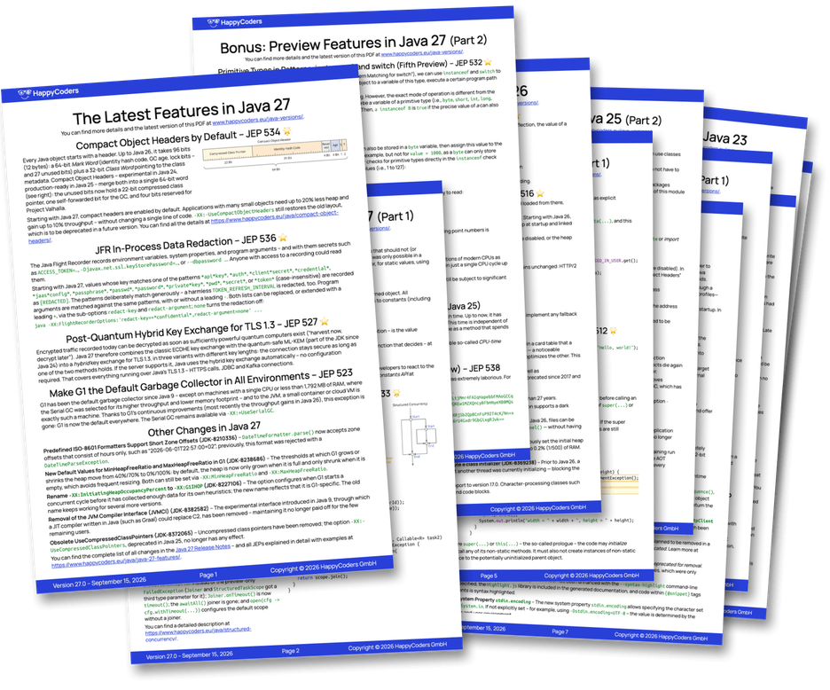
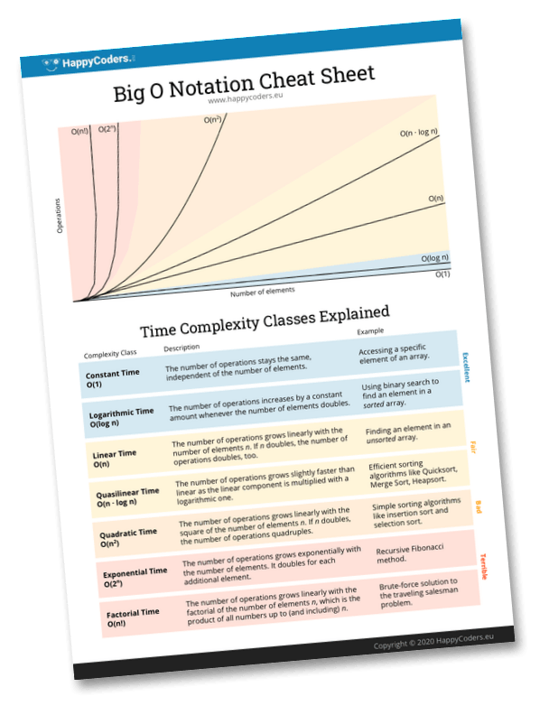

# Java JSON API

Example code for a HappyCoders.eu article on the Simple JSON API of Java 28 – [JEP 540](https://openjdk.org/jeps/540), the incubator module `jdk.incubator.json`, which parses and generates JSON without an external library. The article will be linked here once it is published; until then, see [happycoders.eu](https://www.happycoders.eu/).

## Requirements

The Simple JSON API is an incubator module of Java 28. You need an early-access build of JDK 28 ([jdk.java.net/28](https://jdk.java.net/28/)) and must add the module with `--add-modules jdk.incubator.json`, at compile time and at run time. All outputs in the article and in `results/` come from build 28-ea+23; the API may change until it leaves the incubator.

## Programs

The programs are compact source files in the unnamed package, one directory per topic. Run them from the repository root, where they find `release.json`, the example document of the article:

```
java --add-modules jdk.incubator.json src/main/java/navigating/Navigate.java
```

| Directory | Programs |
|---|---|
| `intro` | `QuickStart` – parse, navigate, convert in three lines |
| `parsing` | `ValueTypes` – the six `JsonValue` subtypes in an exhaustive `switch` |
| `navigating` | `Navigate` – `get(String)`, `get(int)`, iterating over arrays and objects |
| `converting` | `AsStringVsToString` – `asString()` vs. `toString()`; `Conversions` – the other `as…()` methods; `Numbers` – exact and rounding number conversions, `BigDecimal` |
| `optional` | `MissingValues` – `tryGet()` and `tryValue()`; `ChangingTypes` – a member that is a string in one document and a number in another |
| `errors` | `ParseErrors` – `JsonParseException` for invalid JSON; `ValueErrors` – `JsonValueException` with the path to the value |
| `generating` | `Generate` – building JSON from Java objects; `MapOfOrder` – the member order of `Map.of()` changes from run to run; `Modify` – changing an immutable `JsonValue` |
| `equality` | `Equality` – why `equals()` does not compare JSON values, and what to do instead |
| `threaddump` | `ThreadStates` – reads a JSON thread dump of JDK 26, 27 or 28; `Waiter` – a program to take such a dump from |
| `comparison` | `JdkJeps`, `JacksonJeps`, `GsonJeps` – the same task with the JDK API, Jackson 3 and Gson; `JacksonBinding` – data binding to records with Jackson; `EdgeCases` – duplicate names, comments, fractions, strings and overflow in all three |

`threaddumps/` holds the dumps the article analyzes, taken from `Waiter` with JDK 26.0.1, 27 and 28-ea+23:

```
java --add-modules jdk.incubator.json src/main/java/threaddump/ThreadStates.java threaddumps/jdk-26.json
```

To take a dump of your own, start `Waiter` and call `jcmd <pid> Thread.dump_to_file -format=json <file>`.

### Comparison with Jackson and Gson

The comparison programs need Jackson and Gson. Maven downloads them into `target/dependency/`:

```
mvn dependency:copy-dependencies
java --add-modules jdk.incubator.json -cp "target/dependency/*" src/main/java/comparison/JacksonJeps.java
```

`mvn compile` compiles all programs at once, which is what an IDE does when you open the project.

## Reproducing all outputs

`scripts/run-examples.sh <path-to-jdk-28>` runs every program and writes the outputs to `results/<build>/`. It exits with an error if a program fails. Run `mvn dependency:copy-dependencies` first.

The GitHub workflow does both on every push and once a week with the newest JDK 28 early-access build from jdk.java.net, and reports outputs that differ from those of build 28-ea+23 as a warning.


<!-- happycoders-resources:start -->
<!-- Generated from happycoders-website-astro/data/github-readme by scripts/content/sync-github-readmes.mjs. Edit there, not here. -->

## <br>Additional Resources

### <br>Java Versions PDF Cheat Sheet

**Stay up-to-date** with the latest Java features with this **free** [PDF Cheat Sheet](https://www.happycoders.eu/java-versions/)!

[](https://www.happycoders.eu/java-versions/)

* Avoid lengthy research with this **concise overview of all Java versions from Java 10 to Java 27**.
* **Discover the innovative features** of each new Java version, summarized on a single page.
* **Impress your team** with your up-to-date knowledge of the latest Java version.

👉 [Download the free Java Versions PDF](https://www.happycoders.eu/java-versions/)<br>

_(Hier geht's zur deutschen Version &rarr; [Java-Versionen PDF](https://www.happycoders.eu/de/java-versionen/))_


### <br>The Big O Cheat Sheet

With this **free** [1-page PDF cheat sheet](https://www.happycoders.eu/big-o-cheat-sheet/), you'll always have the **7 most important complexity classes** at a glance.

[](https://www.happycoders.eu/big-o-cheat-sheet/)

* **Always choose the most efficient data structures** and thus increase the performance of your applications.
* **Be prepared for technical interviews** and confidently present your algorithm knowledge.
* **Become a sought-after problem solver** and be known for systematically tackling complex problems.

👉 [Download the free Big O Cheat Sheet](https://www.happycoders.eu/big-o-cheat-sheet/)<br>

_(Hier geht's zur deutschen Version &rarr; [O-Notation Cheat Sheet](https://www.happycoders.eu/de/o-notation-cheat-sheet/))_


### <br>HappyCoders Newsletter
👉 Want to stay on top of modern Java?
Sign up for the [HappyCoders newsletter](https://www.happycoders.eu/newsletter/) – Modern Java: new versions & features, performance, and JVM insights – once a month.

_(Hier geht's zur deutschen Version &rarr; [HappyCoders-Newsletter deutsch](https://www.happycoders.eu/de/newsletter/))_


### <br>🇩🇪 An alle Java-Entwickler:innen, die durch fundierte Kenntnisse über Datenstrukturen besseren Code schreiben wollen

Trage dich jetzt unverbindlich auf die [Warteliste](https://www.happycoders.eu/de/mastering-data-structures-warteliste/) von „Mastering Data Structures in Java“ ein, und erhalte das beste Angebot!

[](https://www.happycoders.eu/de/mastering-data-structures-warteliste/)

👉 [Zur Warteliste](https://www.happycoders.eu/de/mastering-data-structures-warteliste/)
<!-- happycoders-resources:end -->
